# ShortLink: a cloud-native URL shortener on Azure Kubernetes Service

A production-style web application that is **designed, provisioned, deployed and automated** on Microsoft Azure using industry-standard DevOps tooling, built as a Cloud/DevOps engineering capstone.


**Stack:** Azure · AKS · Terraform · Docker · Helm · GitHub Actions · Argo CD (GitOps) · Gateway API (Envoy Gateway) · Prometheus · Grafana · k6 · Trivy · MySQL · OIDC

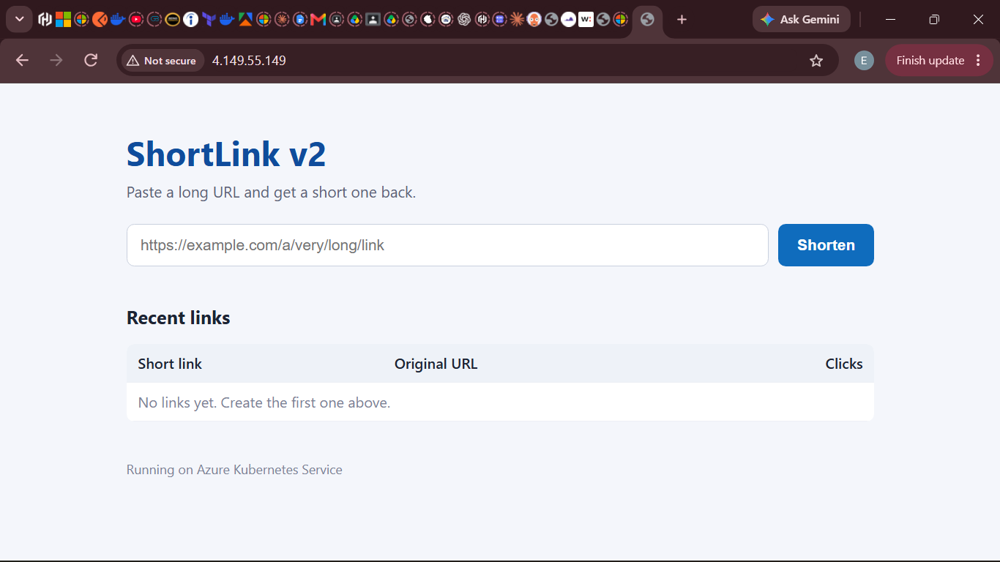

---

## Highlights

- **Infrastructure as Code:** every Azure resource (AKS, ACR, MySQL) is created by Terraform, with remote, versioned state.
- **GitOps delivery:** GitHub Actions builds, tests and scans images, then commits the new image tag to Git. **Argo CD** deploys whatever Git says. Rollback is `git revert`.
- **Security by default:** no cloud passwords in CI (OIDC federation), non-root read-only containers, vulnerability scanning that blocks releases, an internal-only API, TLS to the database, and immutable third-party actions.
- **Proven under load:** **82,747 requests at about 275 req/s with 0% errors**. The API autoscaled from **1 to 4 pods** and back down automatically.
- **Observability:** custom app metrics (traffic, errors, latency) and cluster metrics in Prometheus and Grafana.

---

## Architecture

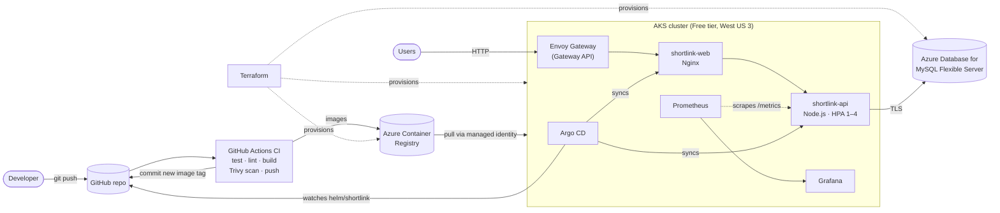

### How a change reaches production

1. A developer pushes code to `main`.
2. **GitHub Actions (CI)** runs the API tests, lints the Helm chart, builds both images, and **scans them with Trivy**. Any fixable HIGH or CRITICAL vulnerability **fails the build**.
3. The images are pushed to **Azure Container Registry**, and the pipeline commits the new image tag to `helm/shortlink/values.yaml`.
4. **Argo CD (CD)**, running inside the cluster, detects the commit and syncs the Helm chart. Kubernetes performs a **zero-downtime rolling update**.

The pipeline never needs cluster credentials. Only Argo CD, inside the cluster, applies changes.

### What each tool does

| Tool | Role in this project |
|---|---|
| **Terraform** | Provisions the resource group, AKS, ACR, MySQL and the AcrPull role assignment; state in Azure Storage |
| **Docker** | Multi-stage, non-root images for the API (Node.js) and frontend (Nginx) |
| **GitHub Actions** | CI: tests, chart lint, image build, Trivy scan, push, GitOps tag update; Terraform plan/apply |
| **Argo CD** | GitOps CD: keeps the cluster in sync with Git, self-heals manual drift |
| **Helm** | Packages all Kubernetes resources for the app with one `values.yaml` |
| **Gateway API + Envoy Gateway** | Routes internet traffic into the cluster (the successor to the retired ingress-nginx) |
| **Prometheus + Grafana** | App metrics (requests, errors, latency) and cluster metrics, with a custom dashboard |
| **HPA** | Scales API pods on CPU (target 60%, 1–4 replicas) |
| **k6** | Load testing, run inside the cluster |
| **Trivy** | Container vulnerability scanning in CI |
| **OIDC (workload identity federation)** | GitHub Actions logs in to Azure with short-lived tokens; no stored secrets |

---

## Results

### GitOps delivery

Argo CD shows every Kubernetes resource the chart deploys, **Healthy** and **Synced** to the latest release commit made by the pipeline.

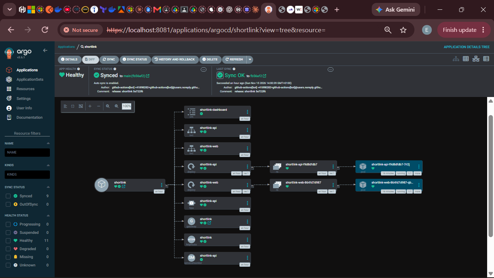

### Load test and autoscaling

**Test:** k6, 150 virtual users for 5 minutes, run **inside the cluster** (so the test measured the app, not a home internet connection).

| Metric | Result |
|---|---|
| Total requests | **82,747** (~275 req/s) |
| Failed requests | **0.00%** |
| Checks passed | **100%** (list = 200, redirect = 302, create = 201) |
| Median latency | **19 ms** |
| p95 latency | **282 ms** (SLO: p95 < 1 s ✓) |
| Peak CPU vs target | **196%** of the 60% target |
| API replicas | **1 → 4 → 1** (automatic scale-up and scale-down) |

**Before:** 1 API pod, CPU at 3% of target.
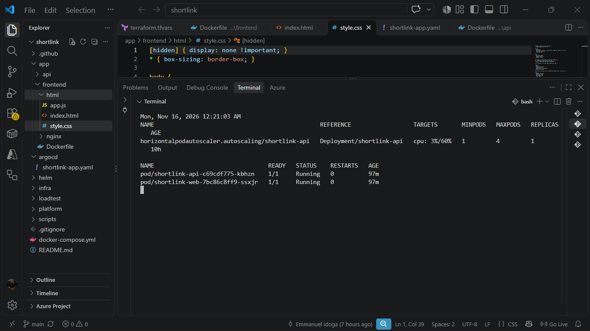

**Under load:** CPU at 196% of target, and the HPA scaled to 4 replicas within about a minute.
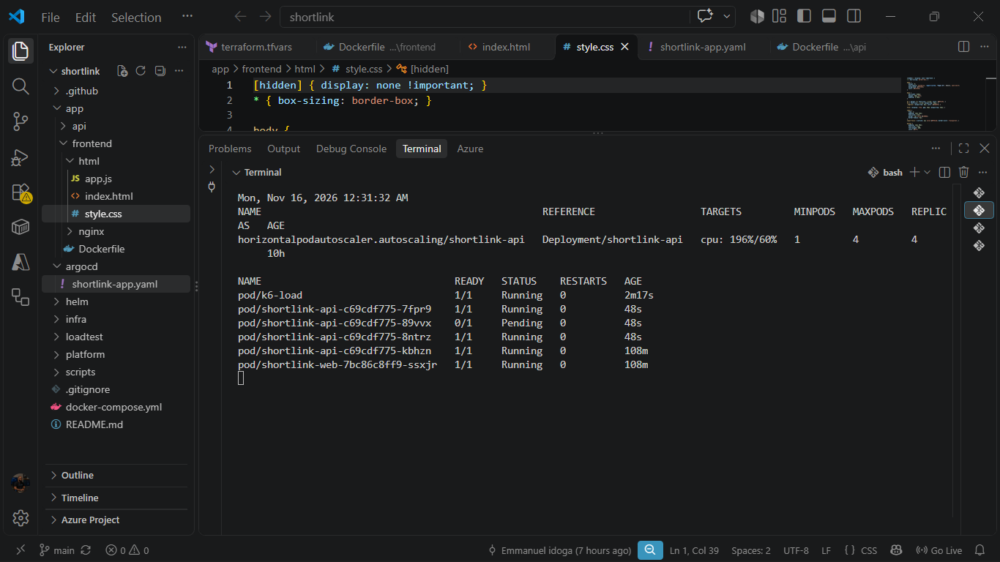

**Grafana during the test:** about 187 req/s, p95 about 198 ms, and API replicas climbing to 4.
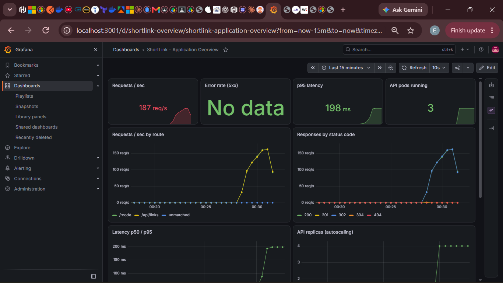

**Argo CD at peak:** the extra pods created by the HPA. The app stays **Synced**, because replica count is owned by the HPA, not Git.
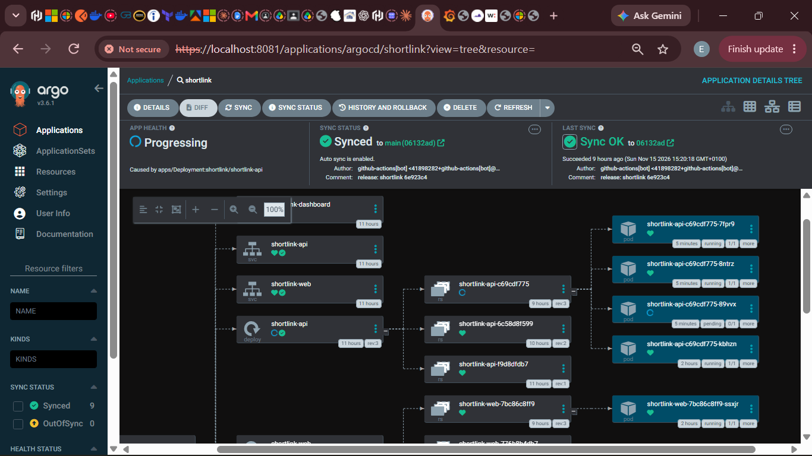

**k6 summary:** 100% checks passed, 0% failed requests, both thresholds met.
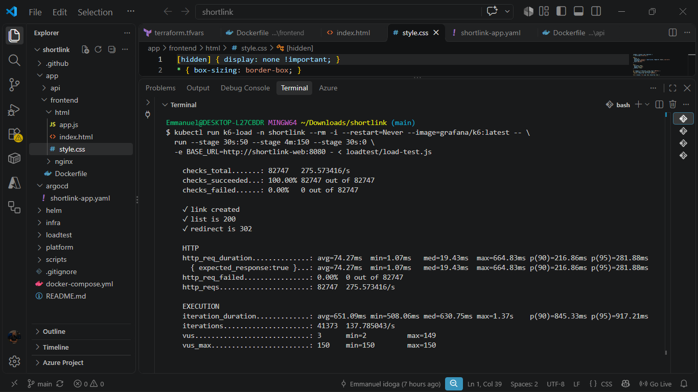
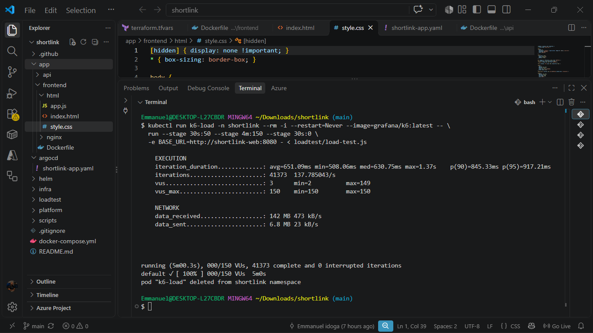

**The full curve:** scale up to 4, then back down after the load ended.
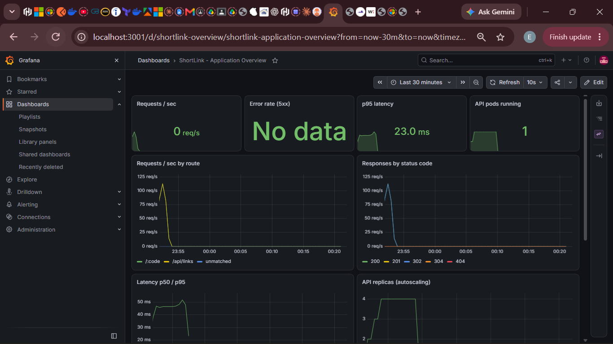

**After:** back to 1 replica and 2% CPU. Kubernetes waits about 5 minutes before scaling down, to avoid flapping.
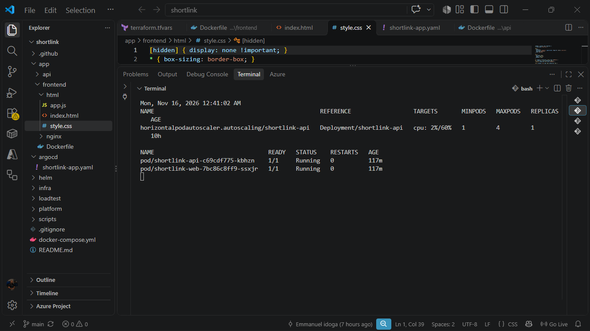

> **Finding: pod autoscaling has a ceiling.** At peak, the 4th API pod stayed `Pending`, because the single node had no allocatable CPU left alongside Argo CD, Prometheus, Grafana and Envoy. The HPA scales **pods**; the **Cluster Autoscaler** scales **nodes**. Production clusters use both. This project uses one node to control cost, and the Cluster Autoscaler is listed under future improvements.

---

## Security

| Practice | Implementation |
|---|---|
| No stored cloud credentials in CI | GitHub Actions authenticates to Azure with **OIDC federated identity** (short-lived tokens, scoped to this repo and branch/environment) |
| Release blocked on vulnerabilities | **Trivy** fails the pipeline on fixable HIGH/CRITICAL CVEs |
| Minimal images | Package managers (npm, yarn, corepack) **removed from the runtime image**; OS packages patched with `apk upgrade` |
| Hardened containers | Non-root users, **read-only root filesystem**, all Linux capabilities dropped, seccomp `RuntimeDefault` |
| Least exposure | API Service is **ClusterIP** (internal only); `/metrics` blocked at the public edge |
| Secrets not in Git | DB password generated by Terraform and stored as a Kubernetes Secret created straight from Terraform outputs |
| Encrypted DB connections | Azure MySQL enforces TLS (`require_secure_transport`); the app verifies the certificate |
| Supply chain | Third-party actions pinned to **immutable releases** after the March 2026 trivy-action tag compromise |
| Registry access | ACR admin user disabled; AKS pulls with its **managed identity** (AcrPull role) |

---

## Repository layout

```
app/
  api/              Node.js API (Express, mysql2, prom-client), tests, Dockerfile
  frontend/         Static HTML/CSS/JS served by Nginx, Dockerfile
infra/              Terraform: resource group, ACR, AKS, MySQL, role assignment
helm/shortlink/     Helm chart: Deployments, Services, HPA, Gateway, HTTPRoute,
                    ServiceMonitor, Grafana dashboard
argocd/             Argo CD Application (points Argo CD at the Helm chart)
platform/           Values for Envoy Gateway, Prometheus/Grafana, Argo CD
scripts/            One-time setup scripts
loadtest/           k6 load test
docs/               Screenshots and demo guide
.github/workflows/  app.yml (CI + GitOps release), infra.yml (Terraform)
docker-compose.yml  Run the whole stack locally
```

---

## Running it yourself

<details>
<summary><b>1. Run locally</b></summary>

```bash
docker compose up --build        # open http://localhost:8080
cd app/api && npm install && npm test
```
</details>

<details>
<summary><b>2. Azure and GitHub setup</b></summary>

On Windows, use **Git Bash**, and run these in every new terminal:
```bash
export MSYS_NO_PATHCONV=1
export ARM_SUBSCRIPTION_ID=$(az account show --query id -o tsv)
```

1. Create a budget alert (Cost Management → Budgets).
2. `az login`
3. `bash scripts/bootstrap-state.sh <region>`: creates the Terraform state storage
4. Create a **public** GitHub repo named `shortlink`
5. `bash scripts/setup-github-oidc.sh <github-username>/shortlink`: passwordless CI login
6. In GitHub → Settings → Secrets and variables → Actions:
   - **Secrets:** `AZURE_CLIENT_ID`, `AZURE_TENANT_ID`, `AZURE_SUBSCRIPTION_ID`
   - **Variables:** `TFSTATE_RESOURCE_GROUP`, `TFSTATE_STORAGE_ACCOUNT`, `ACR_NAME` (added after step 3)
</details>

<details>
<summary><b>3. Provision infrastructure</b></summary>

```bash
cd infra
terraform init -backend-config=backend.hcl
terraform plan
terraform apply
cd ..
az aks get-credentials -g rg-shortlink-prod -n aks-shortlink-prod
kubectl get nodes
```
Check the VM size and region against your subscription's quota first: `az vm list-usage --location <region> -o table`.
</details>

<details>
<summary><b>4. Install the platform</b></summary>

```bash
bash scripts/install-platform.sh    # Envoy Gateway, Prometheus + Grafana, Argo CD
bash scripts/create-db-secret.sh    # DB connection Secret from Terraform outputs
```
</details>

<details>
<summary><b>5. Deploy with GitOps</b></summary>

1. Set your GitHub username in `argocd/shortlink-app.yaml`.
2. Push to `main`. CI builds, scans and pushes the images and commits the new tag.
3. `git pull`, then `kubectl apply -f argocd/shortlink-app.yaml`
4. Get the public IP: `kubectl get gateway shortlink -n shortlink -o jsonpath='{.status.addresses[0].value}'`
</details>

<details>
<summary><b>6. Dashboards and load test</b></summary>

Run each port-forward in its **own terminal** and leave it running:
```bash
kubectl port-forward svc/monitoring-grafana -n monitoring 3001:80      # http://localhost:3001
kubectl port-forward svc/argocd-server -n argocd 8081:443              # https://localhost:8081
```

Watch the autoscaler:
```bash
while true; do clear; date; kubectl get hpa,pods -n shortlink; sleep 5; done
```

Run the load test **inside the cluster**:
```bash
kubectl run k6-load -n shortlink --rm -i --restart=Never --image=grafana/k6:latest -- \
  run --stage 30s:50 --stage 4m:150 --stage 30s:0 \
  -e BASE_URL=http://shortlink-web:8080 - < loadtest/load-test.js
```
</details>

---

## Cost management

| Decision | Effect |
|---|---|
| AKS **Free tier** | No charge for the control plane; only the node VM is billed |
| **One** burstable node (`Standard_B2s_v2`, 2 vCPU / 8 GB) | Smallest size that fits the app, Argo CD and monitoring |
| ACR **Basic**, MySQL **Burstable B1ms** | Cheapest tiers |
| Stop when idle | `az aks stop` and `az mysql flexible-server stop` between work sessions |
| Budget alert | Email alerts at 50% and 90% of a monthly budget |
| Tear down | `terraform -chdir=infra destroy` after the project |

```bash
# Stop / start
az aks stop  -g rg-shortlink-prod -n aks-shortlink-prod
az aks start -g rg-shortlink-prod -n aks-shortlink-prod
# After a start, if pods show ImagePullBackOff: kubectl delete pod -n shortlink --all
```

---

## Challenges & solutions

Real problems hit while building this project, and how each was solved.

| # | Problem | Root cause | Fix | Lesson |
|---|---|---|---|---|
| 1 | AKS failed: VM size not allowed in region | Per-subscription VM size restrictions | Picked an allowed size with the same specs (`Standard_B2s_v2`) | Error messages often contain the fix |
| 2 | `InsufficientVCPUQuota`: 0 vCPUs for the BSv2 family | New subscriptions start with low quotas | Compared quotas across regions with `az vm list-usage` and moved to West US 3 | Quotas are per VM family per region; plan for upgrade surge nodes |
| 3 | Plan showed 5/3 instead of 7/5 when changing region | Child resources referenced the parent by an *unchanging name* | `terraform apply -replace=...` for the database and firewall rule | Always read the plan; `replace_triggered_by` fixes it in code |
| 4 | Apply and Helm installs failed with connection resets | Unstable local connection | Checked real state first (`az aks show`, `helm status`, state lock) before retrying | Never blindly re-run; verify what exists |
| 5 | OIDC login rejected (`AADSTS700213`) | GitHub's token subject included immutable owner and repo IDs | Registered credentials matching the exact subject; the script now registers both formats | Match the presented subject exactly; IDs block repo-name takeover |
| 6 | `trivy-action@0.28.0` not found | Tag removed after the March 2026 supply-chain attack | Moved to the immutable `v0.36.0` release | Pin actions to immutable releases or SHAs; OIDC meant no long-lived secrets to steal |
| 7 | Trivy: 10 HIGH CVEs in the API image | All inside **npm**, bundled in the base image, unused at runtime | Removed package managers from the runtime stage | Remove what you don't need; analyse, don't suppress |
| 8 | Trivy: 1 CRITICAL + 12 HIGH in the frontend image | Base image older than Alpine's security fixes | `apk upgrade` during build + `stable-alpine` tag | Patch what you do need; rebuild images regularly |
| 9 | `az acr login` rejected the registry name | `ACR_NAME` variable never created, so the name was empty | Added the variable, re-ran failed jobs | Check inputs first when an error looks odd |
| 10 | `ImagePullBackOff` (401) after a cluster restart | New node's managed identity not ready for first pulls; back-off delays | Verified AcrPull was correct, then recreated the pods | Verify permissions before changing them; timing matters |
| 11 | 4th autoscaled pod stayed `Pending` | Single node out of allocatable CPU | Documented; Cluster Autoscaler is the production fix | HPA scales pods, the Cluster Autoscaler scales nodes |
| 12 | Result box visible before any link was created | `display:flex` overrode the HTML `hidden` attribute | `[hidden] { display: none !important; }`, shipped via GitOps | Small fixes go through the same audited pipeline |

---

## Future improvements

- **Cluster Autoscaler** (e.g. 1–3 nodes) so scaled pods always fit
- **HTTPS** with a custom domain, cert-manager and Let's Encrypt on the Gateway
- **Azure Key Vault** + Secrets Store CSI driver + Workload Identity for the DB password
- **Private networking** for MySQL (VNet integration, no public endpoint)
- **Alertmanager** routing alerts to email or Slack
- **Least-privilege CI identity** scoped to the project's resource groups
- Argo CD **app-of-apps** so the platform tools are also managed by GitOps
- **Staging environment** with promotion to production via pull request
- **Scheduled weekly image rebuilds** to pick up base-image security patches
- **User accounts**, so each user sees only their own links

---

## Author

**Emmanuel Idoga**: Cloud / DevOps Engineer
GitHub: [@Nuelidoga](https://github.com/Nuelidoga)
